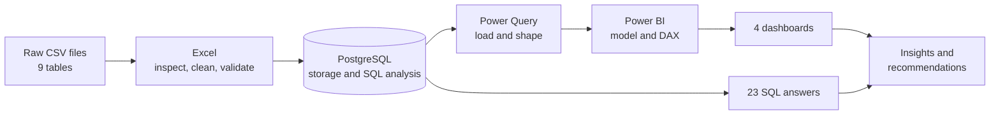
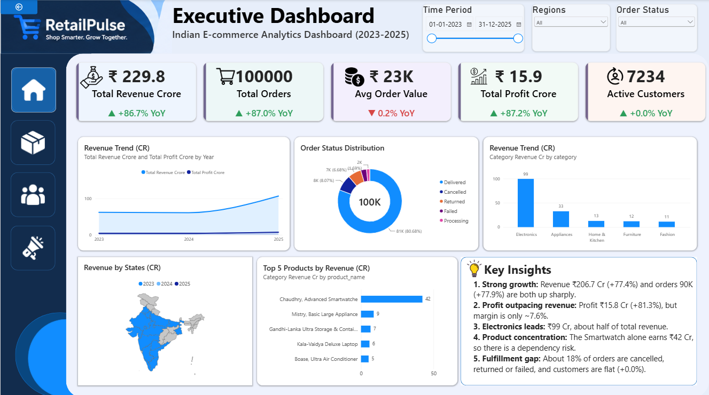
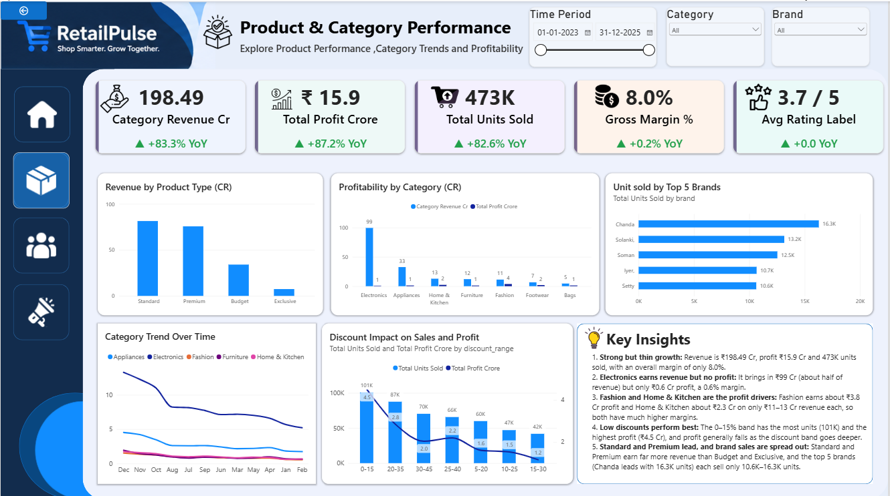
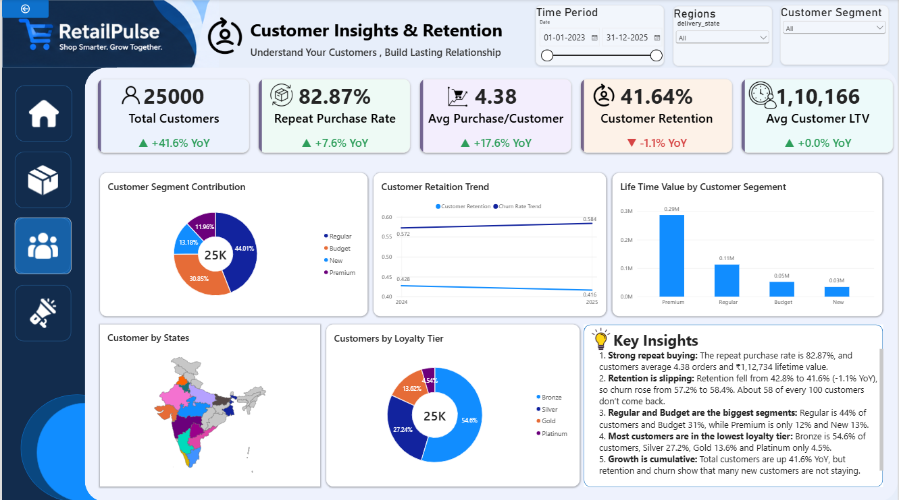
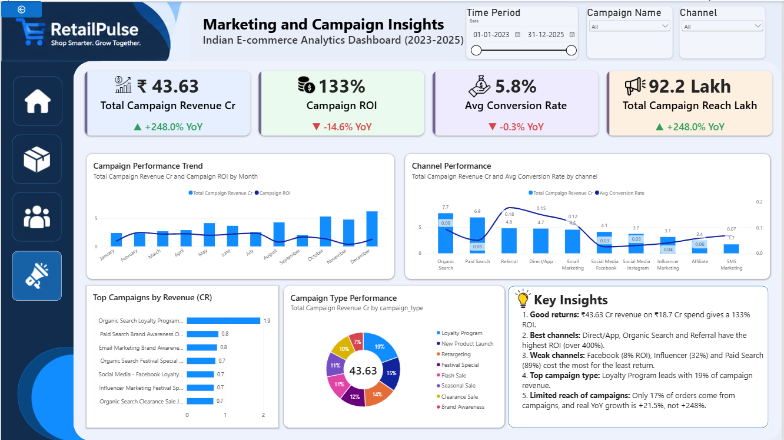

# RetailPulse: E-Commerce Data Analysis Project


> An end-to-end business analytics project for **RetailPulse**, a simulated Indian online marketplace. It answers **23 business questions** across revenue, products, customers, marketing, payments, logistics and returns, using **Excel → PostgreSQL → Power BI**, and turns the findings into prioritised business recommendations.

> **Data credit:** the dataset was obtained through the Kaggle notebook [Indian E-Commerce Sales & Customer EDA 100%](https://www.kaggle.com/code/lalit7881/indian-e-commerce-sales-customer-eda-100/input) by **lalit7881** (see [Acknowledgements](#17-acknowledgements)).

> **Dataset disclosure:** The data is 100% synthetic and was created for educational and portfolio use. It does not represent a real company, real customers or real market performance. Campaign impressions, clicks and ROI are simulated indicators.

---

## Table of contents

1. [Project overview](#1-project-overview)
2. [Business problem and objectives](#2-business-problem-and-objectives)
3. [Dataset](#3-dataset)
4. [Tools and workflow](#4-tools-and-workflow)
5. [Repository structure](#5-repository-structure)
6. [Data cleaning and preparation](#6-data-cleaning-and-preparation)
7. [Exploratory data analysis](#7-exploratory-data-analysis)
8. [SQL analysis: the 23 business questions](#8-sql-analysis-the-23-business-questions)
9. [Power BI dashboards](#9-power-bi-dashboards)
10. [KPI definitions](#10-kpi-definitions)
11. [Key findings](#11-key-findings)
12. [Business recommendations](#12-business-recommendations)
13. [Known issues and metric caveats](#13-known-issues-and-metric-caveats)
14. [Limitations and assumptions](#14-limitations-and-assumptions)
15. [How to reproduce this project](#15-how-to-reproduce-this-project)
16. [Skills demonstrated](#16-skills-demonstrated)
17. [Acknowledgements](#17-acknowledgements)
18. [Author](#18-author)

---

## 1. Project overview

RetailPulse is a simulated mid-sized Indian online marketplace selling across 22 product categories in 15 states. Orders, customers, payments, shipments, returns, reviews and marketing campaigns span **1 January 2023 to 31 December 2025**.

This project:

- prepares and validates the raw data,
- answers 23 management questions with SQL (PostgreSQL),
- builds four interactive Power BI dashboards,
- and converts the results into clear, prioritised recommendations.

**Headline numbers (Executive dashboard, full period):**

| Metric | Value |
|---|---|
| Total revenue | ₹229.8 Cr |
| Total orders | 100,000 |
| Average order value | about ₹23K |
| Total profit | ₹15.9 Cr (about 8% margin on delivered sales) |
| Like-for-like growth, 2025 vs 2024 | about +75% revenue, +74% orders |

---

## 2. Business problem and objectives

**Problem.** RetailPulse processes a large and growing number of orders, but management lacks a single trusted view of what drives profit. It cannot easily see which products and segments earn money, why customers stop buying, which marketing channels bring valuable customers, or how discounts, returns and late deliveries affect margin and satisfaction.

**Objectives**

1. Evaluate revenue, order and profitability trends.
2. Understand product and category performance.
3. Analyse customer segments, repeat purchasing and churn indicators.
4. Evaluate acquisition channels and campaign performance.
5. Assess payments, refunds, delivery, returns and customer satisfaction.

---

## 3. Dataset

**Source:** Kaggle notebook [Indian E-Commerce Sales & Customer EDA 100%](https://www.kaggle.com/code/lalit7881/indian-e-commerce-sales-customer-eda-100/input) by lalit7881, which uses the Kaggle dataset *Indian E-Commerce Sales & Customer Analytics*. The data is synthetic and relational, with nine linked tables.
**Period:** 2023-01-01 to 2025-12-31.

| Table | Rows | Key fields | Purpose |
|---|---:|---|---|
| `customers` | 25,000 | customer_id, state, city, customer_segment, acquisition_channel, customer_status, loyalty_tier, total_orders, total_spend | Segments, repeat purchase, churn, lifetime value, geography |
| `products` | 550 | product_id, product_name, category, brand, price, cost, rating | Category and product profitability |
| `orders` | 100,000 | order_id, customer_id, order_date, order_status, final_amount, discount_percentage, marketing_channel, campaign_id | Revenue trend, order status, AOV, seasonality |
| `order_items` | 254,331 | order_id, product_id, quantity, item_revenue, item_cost, profit | Product revenue, profit, margin, discounts |
| `payments` | 100,000 | order_id, payment_method, payment_status, amount_paid, refund_amount | Payment mix, success rate, refunds |
| `shipments` | 89,681 | order_id, warehouse_city, delivery_city, shipping_method, expected/actual delivery dates, delayed_flag | Delivery efficiency and delays |
| `returns` | 12,075 | order_id, product_id, return_reason, return_status, refund_amount | Return rates and reasons |
| `customer_reviews` | 77,530 | order_id, customer_id, product_id, rating, review_sentiment, verified_purchase | Ratings and sentiment |
| `marketing_campaigns` | 151 | campaign_id, channel, campaign_type, campaign_cost, impressions, clicks, conversions, revenue_generated, roi | Campaign ROI and funnel |

A data dictionary and a validation report (43 automated checks, all passed) accompany the data.

**Geography:** 15 states, 31 delivery cities and 7 warehouses (Hyderabad, Mumbai, Bengaluru, Chennai, Delhi-NCR (Gurugram), Ahmedabad, Kolkata).

---

## 4. Tools and workflow

| Tool | How it was used |
|---|---|
| **Microsoft Excel** | Initial inspection, cleaning checks, validation and transformations before loading |
| **PostgreSQL** | Data storage, joins, CTEs, window functions, KPI calculations for 23 questions |
| **Power BI** | Power Query load from PostgreSQL, data model, DAX measures, four interactive dashboards |



---

## 5. Repository structure

```text
RetailPulse_Analytics/
├── .gitignore
├── README.md
│
├── Analysis_Final_report/
│   ├── DAX_FORMULAS_Ecommerce_Analysis.pdf
│   ├── RetailPulse_Final_Data_Analysis_Report.pdf
│   └── SQL ANALYSIS REPORT of RetailPulse.pdf
│
├── Business_documents/
│   └── RetailPulse_Business_Requirements_Document.docx
│
├── Dashboard/
│   ├── RetailPulse.pbix
│   ├── RetailPulse.pdf    
│
└── dataset/
    └── raw data.zip
```

| Folder / file | What it contains |
|---|---|
| [`Business_documents/`](Business_documents) | Business Requirements Document: the 23 business questions, KPIs, scope and dataset rules |
| [`dataset/`](dataset) | `raw data.zip`: the nine source tables, the data dictionary and the validation report |
| [`Analysis_Final_report/`](Analysis_Final_report) | The SQL analysis report (queries and results for Q1 to Q23), the DAX formulas for the KPI cards, and the final business report |
| [`Dashboard/`](Dashboard) | The Power BI file (`RetailPulse.pbix`), a PDF export of the four dashboard pages, and the screenshots shown in this README |

**Quick links**

- [Business Requirements Document](Business_documents/RetailPulse_Business_Requirements_Document.docx)
- [SQL Analysis Report (PDF)](Analysis_Final_report/SQL%20ANALYSIS%20REPORT%20of%20RetailPulse.pdf)
- [DAX Formulas (PDF)](Analysis_Final_report/DAX_FORMULAS_Ecommerce_Analysis.pdf)
- [Final Data Analysis Report (PDF)](Analysis_Final_report/RetailPulse_Final_Data_Analysis_Report.pdf)
- [Power BI file](Dashboard/RetailPulse.pbix) and [dashboard PDF export](Dashboard/RetailPulse.pdf)
- [Raw dataset (zip)](dataset/raw%20data.zip)

---


## 6. Data cleaning and preparation

Steps were done in the order below.

1. **Inspection and profiling.** Row counts, column types, value ranges and null counts checked for all nine tables.
2. **Missing values.** Every gap was investigated. All were valid business events, so nothing was deleted or filled in.
   - 2,300 missing `last_order_date`: customers who never purchased.
   - 2,321 missing delivery dates: shipments cancelled in transit.
   - 82.8% of orders have no `campaign_id`; 33.7% have no coupon.
   - 10,319 orders have no shipment: cancelled, failed or still processing.
   - Small gaps in age (1.0%), preferred device (0.5%), review sentiment (0.3%), 4 product ratings.
3. **Duplicates.** No duplicate rows or IDs in any table. Several `order_items` rows per order are expected.
4. **Data types.** Dates are stored as text in `dd-mm-yyyy`; they were converted to proper dates.
5. **Integrity.** All 11 foreign-key relationships have zero orphan rows. Business rules (quantity, price, refunds, dates) have no violations.
6. **Transformations.** Derived fields: month and year, MoM and YoY growth, delay days, discount bands, margin %, repeat flag, return and refund rates, CTR and conversion rate.
7. **Validation.** Order subtotals reconcile to order items; 10,690 returned orders match 10,690 refunded orders; customer total spend matches order history.

---

## 7. Exploratory data analysis

EDA was used to understand the data, not to draw business conclusions.

- **Order values are right-skewed:** mean ₹25.7K, median ₹9.5K; the top 10% of orders give 53% of revenue. High-value orders are valid and were kept.
- **Order status mix:** about 81% Delivered, 8% Cancelled, 7% Returned, 3% Failed, 2% Processing (Processing orders are all in late December 2025).
- **Volume is uneven:** steady in 2023 and 2024, then a large jump in Q4 2025.
- **Products are concentrated:** the top 5% of products give about two-thirds of item revenue.
- **Realised margin (about 8%) is far below catalogue margin (about 29%)**, and 14.9% of order items have negative profit, which led to the discount and category margin analysis.
- **Flat patterns:** delay rates look almost identical across cities and warehouses, and order values across channels, so other factors (shipping method, segment) were examined.

---

## 8. SQL analysis: the 23 business questions

The full queries and result tables for all 23 questions are in the [SQL Analysis Report](Analysis_Final_report/SQL%20ANALYSIS%20REPORT%20of%20RetailPulse.pdf).

SQL techniques used: joins (including `FULL` and `LEFT`), CTEs, `LAG` window functions, `PERCENTILE_CONT`, `FILTER` aggregates, `CASE` banding and `NULLIF` guards.

<details>
<summary><strong>A. Revenue and sales performance (Q1 to Q4)</strong></summary>

1. Revenue over time with monthly and yearly growth
2. Revenue lost to cancelled, returned and failed orders
3. AOV by segment, channel and region
4. Seasonality and festival effects
</details>

<details>
<summary><strong>B. Product and profitability (Q5 to Q7)</strong></summary>

5. Top categories and products by revenue and profit
6. High-volume, low-margin products
7. Discount impact on sales, revenue and margin
</details>

<details>
<summary><strong>C. Customer behaviour and retention (Q8 to Q11)</strong></summary>

8. Segment contribution to revenue
9. Repeat purchase rate and frequency
10. Churn and at-risk patterns
11. Historical customer lifetime value by segment and channel
</details>

<details>
<summary><strong>D. Geography and acquisition channels (Q12 to Q14)</strong></summary>

12. Revenue, orders and customers by state and city
13. Channels with the highest spend and repeat behaviour
14. Channel performance by segment and region
</details>

<details>
<summary><strong>E. Marketing effectiveness (Q15 to Q16)</strong></summary>

15. Channel and campaign revenue and ROI
16. Funnel efficiency: impressions to clicks to purchases
</details>

<details>
<summary><strong>F. Payments and finance (Q17 to Q18)</strong></summary>

17. Payment method popularity and success rates
18. Refund exposure and refund-return reconciliation
</details>

<details>
<summary><strong>G. Logistics and delivery (Q19 to Q20)</strong></summary>

19. Shipping method and warehouse efficiency
20. Factors associated with delays
</details>

<details>
<summary><strong>H. Returns and satisfaction (Q21 to Q23)</strong></summary>

21. Return rates and reasons by category
22. Effect of returns and delays on ratings
23. Lowest-rated products, categories and segments, and where to improve
</details>


## 9. Power BI dashboards

Data was loaded from PostgreSQL through Power Query. A calendar table (2023 to 2025) was created in DAX, and each KPI card has a base measure, a prior-period measure, a growth measure, and label and colour measures. All formulas are in [DAX_FORMULAS_Ecommerce_Analysis.pdf](Analysis_Final_report/DAX_FORMULAS_Ecommerce_Analysis.pdf).

| Dashboard | Focus | Main visuals |
|---|---|---|
| **1. Executive** | Revenue, orders, AOV, profit, order status | KPI cards, revenue trend, order status donut, category revenue, state map, top products |
| **2. Product & Category** | Profitability and discounts | Revenue by product type, profit by category, top brands, category trend, discount impact |
| **3. Customer Insights & Retention** | Repeat purchase, retention, value | Segment contribution, retention and churn trend, lifetime value, loyalty tiers, customer map |
| **4. Marketing & Campaign** | Channel and campaign ROI | Campaign trend, channel performance, top campaigns, campaign type mix |

> The four dashboard pages are also available as a [PDF export](Dashboard/RetailPulse.pdf). Screenshots are stored in `Dashboard/screenshots/`.

**1. Executive Dashboard**



**2. Product & Category Performance**



**3. Customer Insights & Retention**



**4. Marketing & Campaign Insights**



---

## 10. KPI definitions

| KPI | Definition | Source tables |
|---|---|---|
| Total Revenue | Sum of `final_amount` for orders that are not Failed or Cancelled (Dashboard 1) | orders |
| Total Orders | Count of `order_id`, all statuses | orders |
| Average Order Value | Total Revenue ÷ Total Orders | orders |
| Total Profit | Sum of item `profit` (item revenue − item cost) for Delivered orders | order_items, orders |
| Category Revenue | Sum of `item_revenue` for Delivered orders | order_items, orders, products |
| Gross Margin % | Total Profit ÷ Category Revenue | order_items, orders |
| Repeat Purchase Rate | Customers with more than one order ÷ customers who ordered | orders, customers |
| Customer Retention | Retained customers ÷ prior-period customers | orders, customers |
| Customer Lifetime Value | Historical spend per customer | orders, customers |
| Campaign ROI | (Revenue generated − campaign cost) ÷ campaign cost | campaigns |
| Conversion Rate | Conversions ÷ clicks | campaigns |
| Payment Success Rate | Successful payments ÷ all payments | payments |
| Refund Rate | Refund amount ÷ amount paid | payments |
| On-time Delivery Rate | Shipments with `delayed_flag = 0` ÷ all shipments | shipments |
| Return Rate | Items returned (not Rejected) ÷ items sold (not Failed) | returns, order_items |
| Average Rating | Mean review rating (1 to 5) | customer_reviews |

---

## 11. Key findings

**Revenue and growth**
- Revenue was about ₹66.1 Cr in 2023, ₹65.2 Cr in 2024 (flat) and ₹113.7 Cr in 2025 (SQL Q1 definition). Q4 2025 alone gave about 46% of 2025 revenue.
- Growth is volume-led: average order value stayed flat.
- About 18% of orders are cancelled, returned or failed, tying up **₹44.4 Cr** of order value.
- Orders around Diwali ran 47% to 71% above the preceding 45-day level.

**Products and profit**
- Electronics gives about half of category revenue at a **0.7% margin**; Appliances earn 3.9%. Fashion (33.1%), Footwear (29.4%), Bags (28.6%) and Home & Kitchen (18.0%) are the profit engines.
- Margin falls from **19.9%** (no discount) to **1.2%** (15 to 20% discount) and turns negative above 20% (-8.8% and -18.1%). Lines discounted above 20% covered ₹53.2 Cr of revenue and lost ₹5.4 Cr.
- One smartwatch gives about one-fifth of revenue at a 1.5% margin.

**Customers**
- About 79% to 83% of customers repeat-purchase, but retention is only **41.6%** and falling (churn 58.4%).
- Churned customers order less often (4.0 vs 4.9 orders), not at lower order values.
- Premium customers are 12% of customers but give 34% of revenue (about ₹2.45 lakh each). New customers repeat only 35% to 45% of the time.

**Marketing**
- ₹43.63 Cr campaign revenue on ₹18.7 Cr spend gives a **133% ROI**.
- Direct/App, Organic Search and Referral return over 400% ROI; Facebook (8%), Influencer (32%) and Paid Search (89%) return far less.

**Operations and satisfaction**
- Same-Day (43.6%) and Standard (46.6%) shipping are on time far less often than Next-Day (89.4%). Delays are about 42% everywhere, so the shipping method matters more than the location.
- On-time orders average 3.93 stars; delayed orders about 3.35; returned items 2.99 stars (30.8% negative reviews).
- Returns are highest in Footwear (8.0%) and Fashion (7.0%), mostly for size issues.
- Payment methods all succeed about 82% of the time. Refunds are ₹26.9 Cr (11.2% of payments), and refund and return records reconcile exactly.

---

## 12. Business recommendations

| Priority | Recommendation | Expected benefit |
|---|---|---|
| High | Cap routine discounts at 15%; approval above 20%; minimum-margin rule | Stops the ₹5.4 Cr loss on deep-discount lines; lifts margin |
| High | Reprice and renegotiate Electronics and Appliances; fix or delist 4 loss-making products | Each 1 point of Electronics margin is worth about ₹1.2 Cr |
| High | Move marketing budget from Facebook, Influencer and low-ROI Paid Search to Direct/App, Referral, Email and Organic | Higher return on the same spend |
| High | Trigger-based win-back for lapsed Premium and Regular customers | Protects the highest-value customers |
| High | Reset delivery promises for Same-Day and Standard; steer volume to reliable methods | Higher ratings, fewer complaints |
| Medium | 30-day second-purchase journey for New customers | Higher repeat rate |
| Medium | Size guides, packaging and accurate listings to cut returns | Lower refund cost, better ratings |
| Medium | Find causes of cancellations and failures; add payment retry | Recover part of the ₹44.4 Cr |
| Medium | Plan stock, carriers and budgets early for each festive season | Fewer stock-outs and delays at the peak |
| Low | Test growth in high-engagement smaller markets (for example Bihar) and reduce single-product dependence | Lower concentration risk |

**What to avoid:** discounts above 20%, more spend on low-ROI social and influencer channels before the funnel is fixed, chasing volume without margin, dependence on one product or three states, and delivery promises the business cannot keep.

---

## 13. Known issues and metric caveats

These issues were found during validation against the raw data. Understanding them is part of the project.

- **Year-on-year cards overstate growth.** With the slicer set to 2023 to 2025, `SAMEPERIODLASTYEAR` shifts the whole window back a year, so the cards compare three years with two. Like-for-like 2025 vs 2024 growth is about **+75%**, not +86.7%. The marketing "+248%" card is affected in the same way; real 2025 vs 2024 campaign revenue growth is +21.5%.
- **Revenue definitions differ across pages.** Dashboard 1 (₹229.8 Cr) excludes only Failed and Cancelled orders; Dashboard 2 (₹198.5 Cr) uses Delivered item revenue. Use one definition for reporting.
- **AOV on Dashboard 1 is understated** because revenue is divided by all orders including cancelled and failed. On completed orders it is about ₹25.7K.
- **Label mismatch in Q10.** The status is stored as `Never Purchased` (with a space), but the query filters on `Never_Purchased`, so never-purchasers stay in the denominator. Among customers who actually bought, churn is higher than the Q10 shares suggest.
- **Q23 segment query** selects the wrong column; the corrected segment ratings are 3.69 to 3.73.
- **Dashboard text boxes** (Key Insights) are static and should be refreshed when the cards change.

---

## 14. Limitations and assumptions

- The dataset is **synthetic**; it does not describe a real company or market.
- **Impressions and clicks are estimates** derived from conversions and assumed rates; ROI depends on the stated campaign cost. Treat funnel results as simulated.
- **Customer status is a snapshot** based on recency against 31 December 2025 (Active within 90 days, At Risk within 180, Churned beyond 180).
- **Profit is item-level** (revenue minus item cost) and excludes other operating costs.
- **Correlation is not causation.** Links between discounts, festivals, delays and outcomes are associations.
- There are no cart, inventory, competitor or support data, so those topics are out of scope.
- The analysis is **descriptive**: no forecasting or machine learning.
- Targets in the recommendations are illustrative and need validation.

---

## 15. How to reproduce this project

### Prerequisites

- PostgreSQL 14 or later (pgAdmin or `psql`)
- Power BI Desktop
- Microsoft Excel (optional, for inspection)

### Step 1: Get the data

1. Unzip [`dataset/raw data.zip`](dataset/raw%20data.zip). It contains nine CSV tables, `data_dictionary.csv` and `dataset_validation_report.csv`.
2. Optionally inspect and clean the files in Excel (see Section 6).

### Step 2: Load the data into PostgreSQL

1. Create a database, for example `retailpulse`.
2. Create the nine tables using the column names and types in `data_dictionary.csv`.
3. Dates in the CSV files use `dd-mm-yyyy`. Either run `SET datestyle = 'DMY';` before loading, or load them as text and convert afterwards.
4. Load each file, for example:

```sql
COPY orders FROM '/path/to/orders.csv' WITH (FORMAT csv, HEADER true);
```

5. Confirm the row counts match the table in Section 3.

### Step 3: Run the SQL analysis

The queries for Q1 to Q23 are shown, with their results, in the [SQL Analysis Report](Analysis_Final_report/SQL%20ANALYSIS%20REPORT%20of%20RetailPulse.pdf). Copy them into pgAdmin or `psql` and run them in order (sections A to H).

### Step 4: Open the dashboards

1. Open [`Dashboard/RetailPulse.pbix`](Dashboard/RetailPulse.pbix) in Power BI Desktop.
2. Update the PostgreSQL connection (server, database, credentials) under *Transform data → Data source settings*.
3. Refresh the data.

### Tips

- Set the date slicer to a **single year** to see correct year-on-year cards, or rebuild the YoY measures with a fixed prior-year filter.
- Keep one revenue definition when comparing SQL and dashboard figures.

---

## 16. Skills demonstrated

- Data profiling, cleaning and validation (Excel, SQL)
- Relational data modelling and advanced SQL (CTEs, window functions, conditional aggregation)
- Power BI data modelling, Power Query and DAX (time intelligence, KPI cards)
- Dashboard design and data storytelling
- Business analysis: profitability, retention, marketing ROI, logistics and customer satisfaction
- Metric reconciliation and transparent documentation of limitations

---

## 17. Acknowledgements

- **Dataset:** obtained through the Kaggle notebook [Indian E-Commerce Sales & Customer EDA 100%](https://www.kaggle.com/code/lalit7881/indian-e-commerce-sales-customer-eda-100/input) by **lalit7881**, which uses the Kaggle dataset *Indian E-Commerce Sales & Customer Analytics*. Thanks to the authors for sharing the data. Please check the dataset page on Kaggle for the original author and licence terms before reusing the data.
- The dataset is synthetic. All analysis, SQL queries, dashboards, findings and recommendations in this repository are my own work.

---

## 18. Author

**Suprakash Saha**
GitHub: [@SuprakashSaha](https://github.com/SuprakashSaha)

---

